# 91 — Backend mimarisi: crate'ler, modüller, akışlar

Durum: **rehber** (2026-10-21). Kapsam: `backend/` (Rust, yalnız `/api/*`, JSON).
Her diyagram kaynak koddan çıkarıldı; bir şey değişirse önce kodu oku, sonra bu
dosyayı güncelle. Dosya yolları `backend/src/` altındadır, aksi yazılmadıkça.

Önce okunacaklar: `spec/15-sinirlar.md` (Rust ile ön yüzün sınırı),
`spec/70-guvenlik.md` (kimlik, CSRF, yetki), `spec/77-gercek-zamanli.md` (soket),
`spec/75-yetki.md` (yetki katmanları), `backend/README.md` (modül haritası).

---

## 1. Bir bakışta: crate ve dış dünya

Tek bir Rust crate'i (`ekiptakip`, sürüm `0.10.4`) var. İçinde workspace yok.
Süreç tek ve bilerek tek: agaç indeksi ve gerçek zamanlı hub süreç belleğinde
(KNOW-85). Tarayıcı, nginx üzerinden aynı kökenden konuşur; Rust yalnız
`127.0.0.1` dinler.

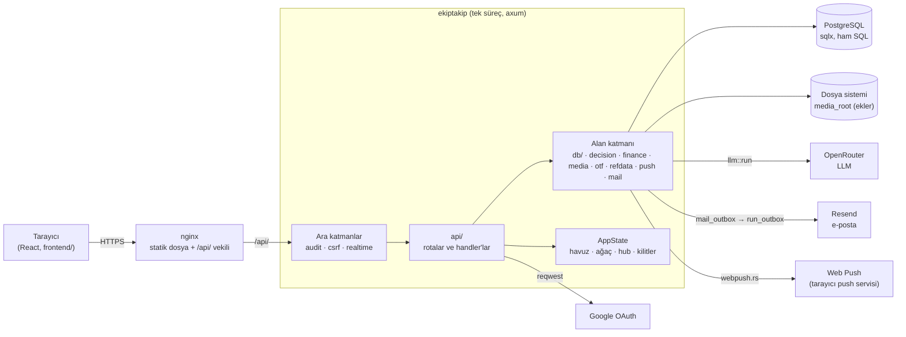

Bağımlılıklar (`backend/Cargo.toml` ve `backend/README.md`):

| crate | işi | nerede kullanılır |
|---|---|---|
| `axum`, `tokio` | HTTP, asenkron çalışma zamanı | `main.rs`, `api/`, `realtime.rs` |
| `sqlx` | Ham SQL, ORM yok (KNOW-178); göçler ikiliye gömülü | `db/`, `api/`, `migrations/` |
| `axum-extra` (`cookie-signed`) | İmzalı oturum çerezi | `auth.rs` |
| `reqwest` | Google OAuth, OpenRouter, Resend | `api/auth.rs`, `openrouter.rs`, `mail.rs` |
| `serde`, `serde_json` | JSON, `manifest.json` | her yerde |
| `image` | Ek yeniden kodlama (EXIF düşer) | `media.rs` |
| `zip` (yalnız deflate) | OTF `.docx` doldurma, Excel çıktısı | `otf.rs`, `xlsx.rs`, `purchases_xlsx.rs` |
| `p256`, `hkdf`, `aes-gcm` | Web Push şifreleme (RFC 8291/8292), elle | `webpush.rs` |
| `chrono`, `uuid`, `base64`, `sha2`, `time` | Zaman, kimlik, kodlama, özet | her yerde |
| `tower-http` (`trace`) | İstek günlüğü | `main.rs` |
| `tracing` | Günlük | her yerde |

Sıkılık: `Cargo.toml` `[lints]` bölümü `todo!`, `unimplemented!`, `unwrap`,
`expect`, `panic!` ve `unsafe` kullanımını derlemeyi düşürecek şekilde yasaklar
(testlerde serbest). Kontrol: `cargo clippy --all-targets`.

---

## 2. Modül haritası: hangi dosya ne yapar

Dosyalar üç katmana ayrılır. Üst katman alt katmanı çağırır, tersi olmaz:

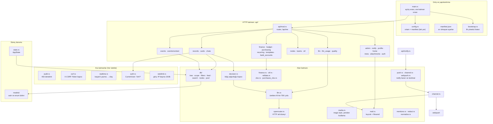

Dosya tablosu (kısa): her satır, bir işi aradığında açılacak ilk dosya.

| Ne arıyorsun | Açılacak dosya |
|---|---|
| Yeni bir uç (route) ekleme | `api/mod.rs` (router) + ilgili `api/*.rs` |
| "Bu kullanıcı şunu yapabilir mi?" | `auth.rs` (kim) + `db/scope.rs` (ne yapabilir, nerede) |
| Kayıt / eylem / kart kuralları | `api/records.rs`, `api/cards.rs` |
| Etkinlik kuralları | `api/events.rs`, `api/events/context.rs` |
| Ağaç (birim, takım, etkinlik türü) | `db/tree.rs`, `api/nodes.rs`, `refdata.rs` |
| Gerçek zamanlı olay | `realtime.rs` |
| AI çağrısı, limit, kayıt | `llm.rs` (yol), `openrouter.rs` (HTTP), `api/llm.rs` (yönetim) |
| Bildirim (kim, ne zaman, hangi kanal) | `push.rs` (karar), `channel.rs` (protokol), `api/notify.rs` |
| Ek yükleme | `media.rs`, `api/attachments.rs` |
| Maliye hesapları | `finance.rs` (saf kurallar), `api/finance.rs` (uçlar) |
| Yeni veritabanı tablosu | `migrations/NNN_*.sql` (sıradaki numara) |

---

## 3. Açılış sırası

Her açılışta `main.rs` şu sırayla çalışır. Sıra önemli: göçler, varsayılan LLM
satırları ve ağaç indeksi, istekler başlamadan hazır olmalı.

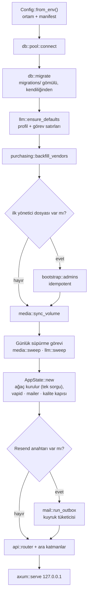

`--workers 1` kuralı ve neden: ağaç indeksi (`TreeIndex`) ve hub süreç
belleğindedir. İkinci süreç ayrı bir ağaç tutar ve olayları görmez.

---

## 4. AppState: istekler arasında paylaşılan şey

`state.rs` her handler'a `State<AppState>` olarak gelir. Klon ucuzdur: her
alan `Arc` veya havuz tutucusudur.

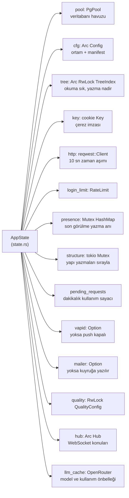

Kilit kuralları (kodda yorumlu):

- `tree` için `std::sync::RwLock`: kilit `.await` üzerinden taşınamaz, bu bilerek
  derleme zamanında engellenir.
- `structure` için `tokio::sync::Mutex`: yapı yazmaları (düğüm ekle/taşı/sil)
  sırayla çalışır; iki eşzamanlı taşıma eski ağaca bakıp döngü kurmasın diye.
- Ağaç her yapısal yazmadan sonra **tamamen** yeniden kurulur (`rebuild_tree`),
  kısmi güncelleme yoktur (KNOW-179).

---

## 5. İstek zinciri: bir HTTP isteği içeriden nasıl geçer

`main.rs` katmanları axum'da **son eklenen en dışta** çalışacak şekilde ekler.
Gelen istek, aşağıdan yukarıya değil yukarıdan aşağıya girer:

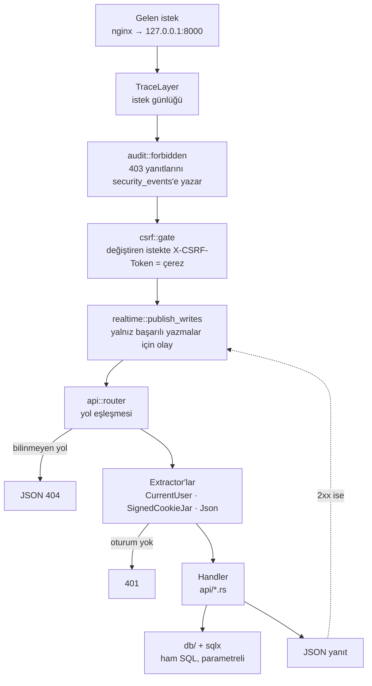

Önemli sonuçlar:

- CSRF reddi (403) ve yetki reddi, handler'a hiç ulaşmaz. Olay da üretmez: olay
  katmanı CSRF'in **içinde**.
- Denetim (`audit`) CSRF'in **dışında**: kapının reddi de kayda girer.
- Yeni bir uç `AppError::Forbidden` döndürdüğünde denetime kendiliğinden girer.
- Handler panik etmez: `unwrap` ve `expect` derleyiciyle yasak.

---

## 6. Oturum ve giriş

Kimlik tek yerde çözülür: `auth.rs` içindeki `CurrentUser` extractor'ı. Her
istekte kullanıcı **veritabanından** okunur. Çerezde rol veya kapsam yoktur;
böylece bir kullanıcının kapatılması bir sonraki istekte etkili olur (KNOW-97).

### 6.1 Google ile giriş

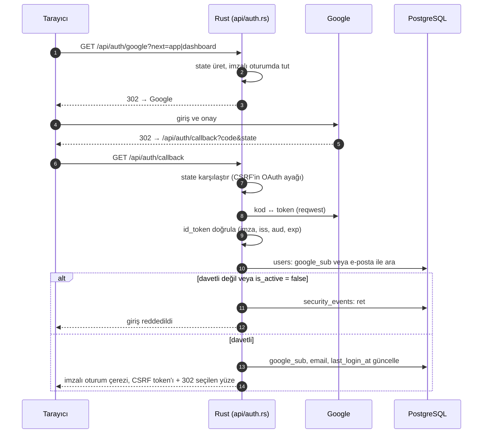

Notlar:

- Davetli listesi `users` tablosudur. Listede olmayan e-posta giremez.
- Giriş uçları IP başına dakikada 10 istekle sınırlıdır (`login_limit`).
- Yerelde `EKIPTAKIP_AUTH=sahte` ile Google atlanır (`/api/auth/dev-login`);
  yayında bu yol reddedilir.

### 6.2 Her istekte "kim?"

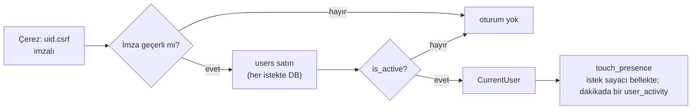

---

## 7. Yetki: dört katman

Yetki sorusu üç parçaya ayrılır: **ne yapabilirsin**, **nerede**, **bu kayıt
senin mi**. `spec/75-yetki.md` ayrıntıyı verir; burada yalnız akış.

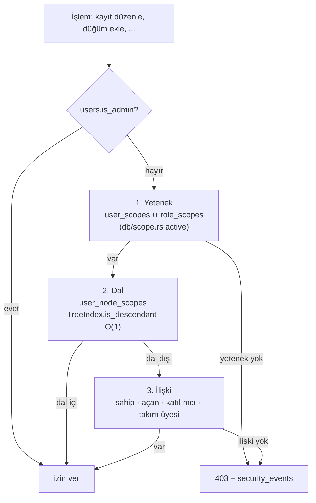

Yetenek ile ilişki bilerek ayrıdır (KNOW-64): "kapsamın var ve o dalda
düzenlersin" ile "bu kayıt senin" farklı sorulardır. Admin, `scopes`
tablosundaki her yeteneğe sahip sayılır; bu kontrol tek yerde yapılır.

---

## 8. Yazma akışı ve gerçek zamanlı kanal

Bir değişikliğin hayatı: veritabanına yazılır, başarılı yanıt sonrası hub'a
"bu kimlik değişti" denir, tarayıcı veriyi yeniden REST'ten çeker.
**Olay veri taşımaz.**

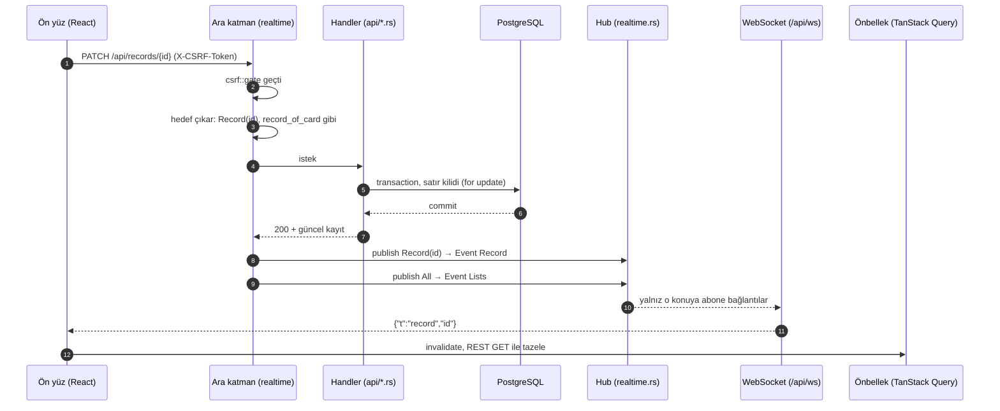

Hub'ın kuralları:

- Olay üç çeşittir: `Record { id }`, `Chat { id }`, `Lists` (kimliksiz, herkese).
- Konular: `All` (herkes otomatik), `Record(id)`, `Chat(id)`. İstemci yalnız
  `record:<uuid>` ve `chat:<uuid>` isteyebilir.
- Sohbet konusu, akış ucuyla **aynı** yetki kuralını kullanır
  (`chats::authorize_read`, gizli kayıt).
- Bağlantı başına 64 konu sınırı; istemci kuyruğu dolarsa bağlantı düşürülür.
  İstemci yeniden bağlanıp her şeyi tazeler (tekrar oynatma tamponu yok).
- Sunucu 25 sn'de bir ping atar; 75 sn çerçeve gelmezse kapatır.
- Çok süreç gerekirse hedef Postgres `LISTEN/NOTIFY`'dır. Konu ve olay biçimi
  değişmez (KNOW-85).

Ara katmanın hangi yazmayı nasıl sınıflandırdığı `realtime::target` içindedir.
Yeni bir yazma ucu `/api/records/{id}/…`, `/api/cards/{id}`,
`/api/actions/{id}`, `/api/chats/{id}/messages` altındaysa kendiliğinden
kapsanır. Başka bir yola konursa `target()` ve birim testi güncellenmelidir.

---

## 9. Bellekteki ağaç indeksi

Ağaç (birimler, takımlar, etkinlik türleri, kazanım ağaçları) veritabanında
`nodes.parent_id` ile tutulur. Yetki kontrolü her istekte SQL'e gitmesin diye
belleğe tam kopya alınır.

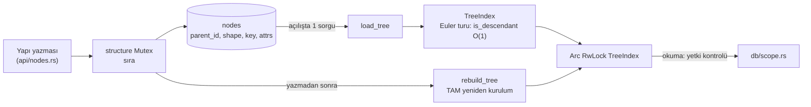

Ağacın kökleri (`key` dolu) `refdata.rs` içindeki şemaya göre davranır: hangi
tür nereye girer, şekil (`leaf`, `list`, `tree`) ve öznitelikler. Kod kökü
adıyla değil `key` ile bulur.

Etkinlik ve kayıtlar için ayrı bir ağaç yoktur; ağaç yalnız yapıyı taşır.

---

## 10. LLM çağrısı: tek yol

Her üretken yapay zeka çağrısı `llm::run`'dan geçer. Doğrudan HTTP çağrısı
yasaktır. Bu kural `spec/79-llm-yuku.md` §11 içindedir.

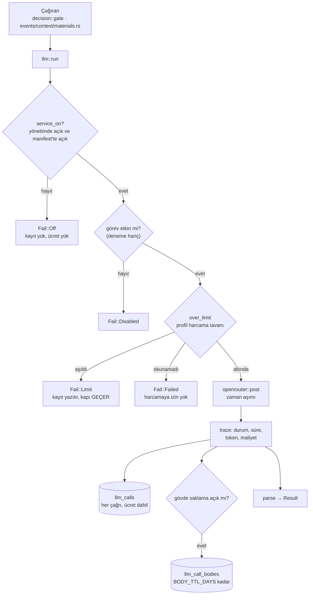

Sahiplik:

- `llm.rs`: sözleşme (görev adı, uç türü, şema), profil birleşimi, limit, kayıt.
- `openrouter.rs`: yalnız HTTP. Anahtar yalnız `Authorization` başlığına gider;
  istem ve yanıt gövdesi loglanmaz.
- `decision.rs`: bilgi yoğunluğu kapısı. Servis kapalıysa sessizce geçer; uzunluk
  kuralı yine API'de çalışır.
- `api/llm.rs`, `api/llm_usage.rs`: yönetim paneli uçları.

Görev → profil ilişkisi: bir görev (`llm_tasks`) bir profile (`llm_profiles`:
model, parametre, dolar limiti) bağlanır. Kod model adı bilmez.

---

## 11. Bildirim: karar, kanal, teslimat

Bildirim iki ayrı soruyu ayırır. **Kime, ne zaman, hangi kademe?** `push::decide`
tek kapıdır; **nasıl teslim?** `channel.rs` protokolüdür.

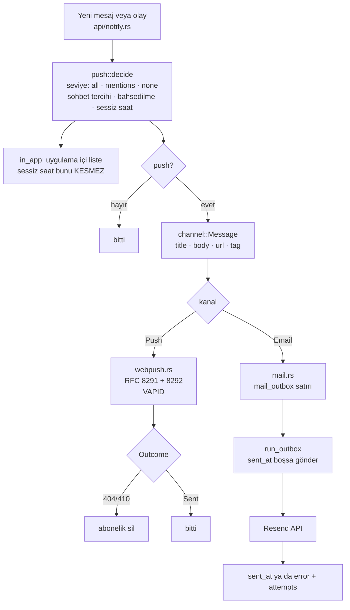

Önemli: e-posta kuyruğu bir **tablodur** (`mail_outbox`). Gönderici bağlı
değilse satırlar birikir; bağlanınca tüketilir. Davet postası da bu kuyruktan
gider (`api/admin.rs` → `mail::enqueue`).

Web Push, `vapid` anahtarı yoksa kapalıdır; uygulama içi liste yine çalışır.

---

## 12. Kayıt, eylem, etkinlik: hangi tablo ne taşır

Kayıt (`records`) bir iştir; eylemler (`actions`) ona bağlı alt işlerdir.
Etkinlik (`events`) planlama nesnesidir ve her etkinliğin bir **ikiz kaydı**
(`events.record_id`) vardır: sohbet, arşiv ve eylemler oradadır.

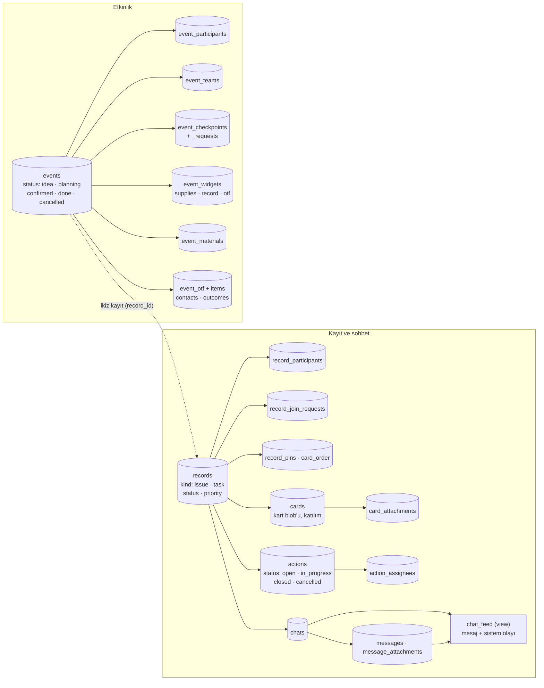

Durum kümeleri (kodda, `models/enums.rs`):

- Kayıt: `open`, `in_progress`, `pending`, `closed`, `cancelled`.
  Eylemde `pending` yoktur; iki enum bilerek ayrı tutulur.
- Eylem: `open`, `in_progress`, `closed`, `cancelled`.
- Etkinlik: `idea`, `planning`, `confirmed`, `done`, `cancelled`.

Bu diyagram yalnız değer kümelerini gösterir. Hangi durumdan hangi duruma
geçildiği `api/records.rs` ve `api/events.rs` içindedir; bu dosyalar geçişleri
kendileri doğrular, rehber bunları tekrar etmez.

---

## 13. Veri modeli: tablo grupları

Şema bugün `backend/migrations/001…029` ile kuruludur. Yeni bir göç **sıradaki
numarayla** eklenir. Mevcut dosya adları donuktur: uygulanmış bir göç yeniden
adlandırılırsa yeniden çalışır.

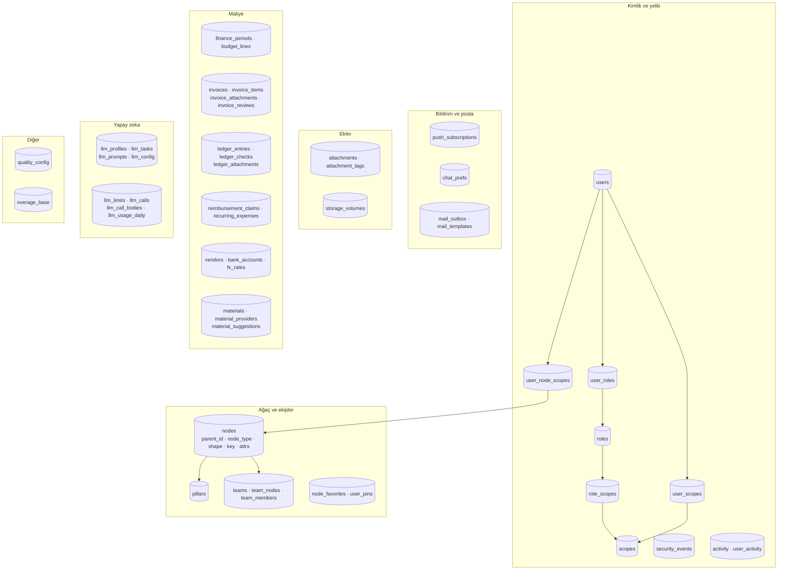

Dikkat: `db/` altındaki bazı modüller henüz tam kullanılmıyor; `main.rs` bunu
`#[allow(dead_code)]` ile açıkça söyler. Yeni bir JSON ucu bu modüllere
bağlanır, yeniden yazılmaz.

---

## 14. Bir isteği baştan sona izlemek: örnek

Bir kullanıcı bir kayda yeni bir eylem ekliyor. Okuman gereken dosyalar sırasıyla:

1. `api/mod.rs`: `POST /api/records/{id}/actions` hangi handler'a gidiyor.
2. `csrf.rs` ve `auth.rs`: kim ve geçerli bir token mı.
3. `db/scope.rs`: kullanıcının dalda yetkisi var mı (`permitted_nodes`).
4. `api/records.rs`: `add_action` iş kuralları ve `activity` yazımı.
5. `realtime.rs`: `target()` bu yolu `Record(id)` olarak sınıflandırıyor mu.
6. Yanıt, ön yüzdeki önbelleği tazeler; ön yüz ayrıca `lists` olayıyla ana
   sayfa ve eylemlerim listesini yeniler.

Aynı izleme yolu, bir AI çağrısı için `llm::run` üzerinden, bir bildirim için
`push::decide` üzerinden geçer.

---

## 15. Bilinen sınırlar ve açık noktalar

- **Tek süreç.** Yatay ölçek için ağaç indeksi, hub ve `structure` kilidi
  `LISTEN/NOTIFY` ve veritabanı kilidiyle değiştirilmeli (KNOW-85).
- **Eski isimler.** Kod İngilizce; ancak `spec/` belgeleri ve commit geçmişi bazı
  eski Türkçe adları anar. Kod referans alınır.
- **Tasarım aşamasındaki belgeler.** `spec/81-maliye.md`, `spec/85-embedding.md`
  (pgvector), `spec/86-baglantilar-graf.md` durumları "tasarım"dır. Bu belgelerdeki
  bir özelliğin kodda var olup olmadığını önce `grep` ile doğrula.
- **Python arşivi.** `references/python/` yalnızca davranış başvurusudur; yeni
  özellik oraya yazılmaz.
